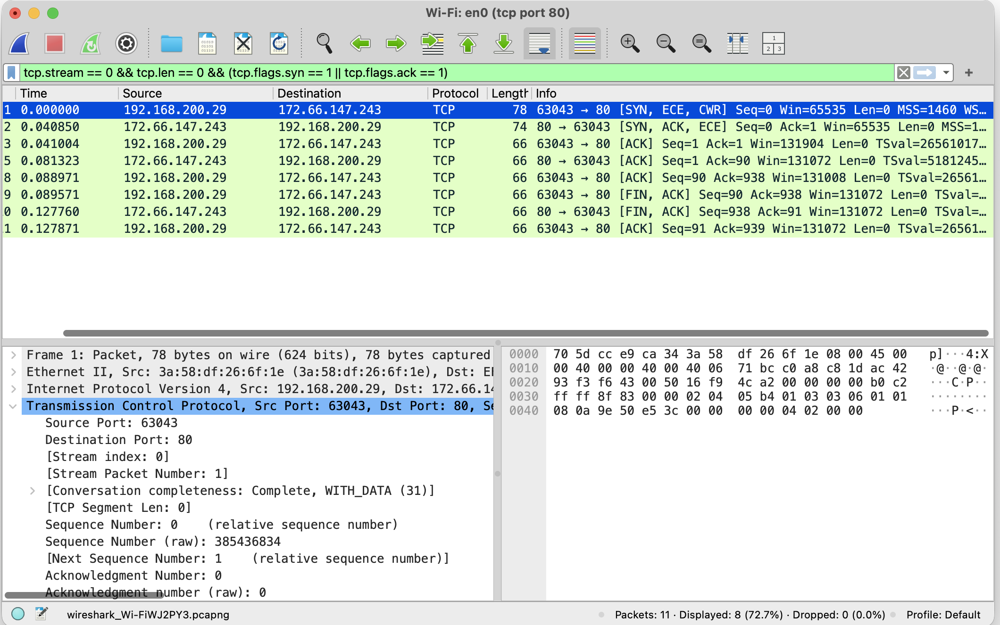
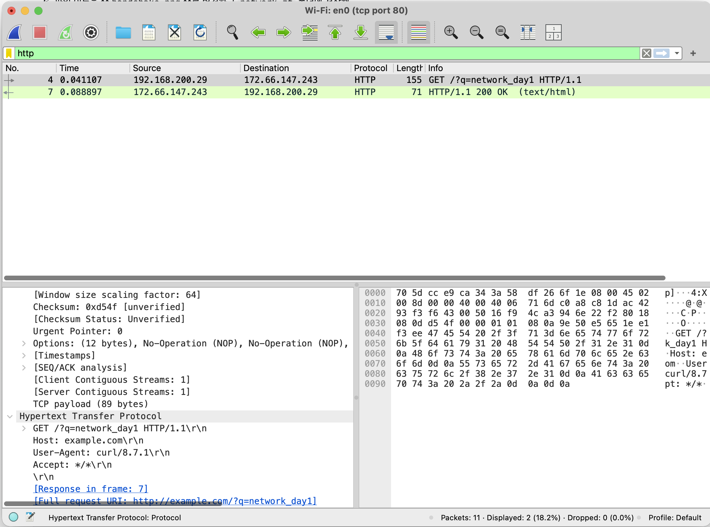

# Network-029 패킷 분석 보고서 (이름)

> **쓰는 법**
> - 문제를 하나 풀 때마다 그 교시의 **문제 소제목 아래**를 채웁니다.
> - **값을 적는 줄**(끝이 `:`)은 콜론 뒤에 내 화면의 값을 씁니다.
> - **생각하는 질문**(물음표)은 아래 `답:` 뒤에, 내가 확인한 것과 그렇게 생각한 이유를 씁니다. 길어지면 다음 줄에 이어 써도 됩니다.
> - 🔍 는 그 교시에 배운 내용으로 답하는 핵심 질문입니다. 답을 못 찾았으면 「모름 — 막힌 곳: …」 을 씁니다.

---

## 5교시 · TCP

### 문제 5-1 · 직접 실행해 보기

- 출력 세 줄: True False 443
- 탐지 코드에서 플래그를 `==` 로 검사하면 어떤 일이 생기나요? 둘째 줄을 근거로 설명합니다.
  - 답: ==로 검사하면 리스트 전체와 문자열을 비교하기 때문에, 리스트 안에 해당 플래그가 있어도 False가 나옵니다. 따라서 오류는 발생하지 않지만, 탐지해야 할 플래그를 찾지 못할 수 있습니다.

### 문제 5-2 · TCP 일까 UDP 일까

- ① ~ ⑤ 가 각각 TCP · UDP · ICMP 중 무엇인지:
1. 카카오톡으로 사진 파일 보내기: TCP
2. 유튜브 실시간 방송 보기: UDP
3. requests.post로 LLM 호출하기: TCP
4. google.com의 IP 주소 조회(DNS): UDP
5. ping 8.8.8.8: ICMP
- ① 사진 파일 보내기가 TCP 인 이유는 무엇인가요?
  - 답: 사진 파일은 데이터가 누락되거나 순서가 바뀌면 파일이 손상될 수 있기 때문에, 데이터의 전달 여부를 확인하고 손실된 데이터를 재전송하는 TCP를 사용합니다.

### 문제 5-3 · 세 번의 순서 맞히기

- 세 패킷의 순서와 방향: (나), (가), (다)
- 🔍 연결을 맺을 때는 세 번인데, 끝낼 때는 왜 네 번인가요?
  - 답: 연결할 때는 SYN과 ACK를 하나의 패킷으로 함께 보낼 수 있어 세 번이면 됩니다. 하지만 연결을 종료할 때는 상대방이 아직 보낼 데이터가 남아 있을 수 있기 때문에 ACK와 FIN을 따로 보내야 하므로 일반적으로 네 번의 과정이 필요합니다.

### 문제 5-4 · 같은 서버로 간 두 연결은 무엇이 다른가

- 두 연결에서 같은 것 · 다른 것:
같은 것: 출발지 IP(192.168.0.15), 목적지 IP(142.250.196.110), 목적지 포트(443)
다른 것: 출발지 포트(51234, 51240)
- 같은 서버로 간 두 연결을 무엇으로 구별하나요?
  - 답: 같은 서버에 연결하더라도 출발지 포트 번호가 다르기 때문에 각각의 연결을 구별할 수 있습니다.

### 이 교시에 새로 안 것

- 이 교시에서 새로 알게 된 것: TCP와 UDP의 차이를 이해했고, TCP가 SYN → SYN/ACK → ACK의 3단계로 연결을 맺고 FIN과 ACK를 통해 연결을 종료한다는 것을 알게 되었다. 또한 하나의 PC가 같은 서버에 여러 번 연결하더라도 출발지 포트 번호로 각각의 연결을 구별할 수 있다는 점을 새롭게 알게 되었다.

---

## 6교시 · Wireshark

### 실습 1 · 캡처하고 통신 방향 읽기

#### 문제 6-1 · Wireshark 실행하기

- 고른 인터페이스 이름: Wi-Fi: en0

#### 문제 6-2 · 캡처한 통신의 방향 읽기

- `Packets` 숫자 · Protocol 열의 이름 세 개: 3,348개 / TCP, TLSv1.3, UDP
- `숫자 → 443` 과 `443 → 숫자` 가운데 어느 줄이 요청인가요? 그렇게 판단한 이유는 무엇인가요?
  - 답: 숫자 → 443이 내 PC에서 서버로 보내는 방향이다. 443은 서버의 HTTPS 포트이고, 다른 숫자는 내 PC에서 사용하는 임시 포트이기 때문이다.

### 실습 2 · 패킷 내용을 해석하고 필터로 확인하기

#### 문제 6-3 · 패킷 하나를 층별로 펼치기

- Source MAC · Source IP / Destination IP · Time to Live · Source Port / Destination Port · Flags:
Source MAC: 3a:58:df:26:6f:1e
Source IP: 192.168.200.29
Destination IP: 104.18.32.47
TTL: 64
Source Port: 62790
Destination Port: 443
Flags: ACK
- 이 패킷은 내 PC 가 보낸 것인가요, 받은 것인가요? 어떻게 알았나요?
  - 답: 내 PC가 보낸 패킷이다. 출발지 IP가 내 PC의 IP 주소인 192.168.200.29이고, 목적지 IP가 외부 서버의 IP 주소인 104.18.32.47이기 때문이다.

#### 문제 6-4 · 필터 결과와 뜻 비교하기

- 전체 `Packets` · `dns` · `udp` · `tcp.port == 443` 의 `Displayed`:
전체 Packets: 3,348개
dns: 34개
udp: 1,037개
tcp.port == 443: 2,171
- 필터를 걸어도 `Packets` 는 그대로인데 `Displayed` 만 바뀌는 이유는 무엇인가요?
  - 답: 표시 필터는 캡처한 패킷을 삭제하지 않고 조건에 맞는 패킷만 보여주기 때문이다. 따라서 전체 패킷 수는 유지되고, 필터 조건에 따라 화면에 표시되는 패킷 수만 달라진다.

### 이 교시에 새로 안 것

- 이 교시에서 새로 알게 된 것: Wireshark를 이용해 실제 네트워크 패킷을 캡처하고, MAC 주소, IP 주소, 포트 번호, TTL을 확인하는 방법을 배웠다. 또한 패킷의 출발지와 목적지를 통해 통신 방향을 구별할 수 있었고, 표시 필터를 사용하면 전체 패킷 중 원하는 조건에 맞는 패킷만 골라 분석할 수 있다는 것을 알게 되었다.

---

## 7교시 · 패킷 분석

### 문제 7-1 · 내 HTTP 연결 하나만 잡기

- `handshake.png` 저장 · 세 줄 Info 의 신호 순서:
  1. SYN, ECE, CWR: 192.168.200.29 → 172.66.147.243
  2. SYN, ACK, ECE: 172.66.147.243 → 192.168.200.29
  3. ACK: 192.168.200.29 → 172.66.147.243

### 문제 7-2 · HTTP 요청과 연결 종료 찾기

- 요청 줄의 Info · FIN 줄 수:
HTTP 요청: GET /?q=network_day1 HTTP/1.1
FIN 패킷: 2개 (양쪽에서 각각 FIN, ACK 전송)
- 🔍 내 검색어가 그대로 보인 것은 HTTP 이기 때문입니다. 같은 요청을 HTTPS 로 보냈다면 어떻게 보였을까요?
  - 답: HTTPS는 데이터를 암호화하기 때문에 HTTP처럼 요청 경로나 검색어가 그대로 보이지 않고, 암호화된 데이터로 표시된다.

### 문제 7-3 · 보고서 완성하고 올리기

- 깃허브 `network_zt` 폴더에 보고서와 사진 두 장이 보이나요:

### 이 교시에 새로 안 것

- 이 교시에서 새로 알게 된 것: Wireshark에서 curl 명령으로 직접 HTTP 통신을 발생시키고, SYN → SYN/ACK → ACK의 3-way handshake 과정을 실제 패킷으로 확인했다. 또한 FIN 패킷을 통해 TCP 연결이 종료되는 과정을 이해했고, HTTP는 암호화되지 않아 요청 내용이 그대로 보이지만 HTTPS는 암호화되어 내용을 쉽게 확인할 수 없다는 점을 새롭게 알게 되었다.
---

## 최종 분석 — 7교시에 완성합니다

> 오늘 잡은 **내 HTTP 연결 하나**를 처음부터 끝까지 정리합니다. 위에서 적은 6-3 · 7-1 · 7-2 의 답을 다시 보며 씁니다.

### 1. 연결이 열리는 순간 — 3-way handshake

- 세 줄의 Source → Destination 과 Info:
1. 192.168.200.29 → 172.66.147.243 / SYN, ECE, CWR
2. 172.66.147.243 → 192.168.200.29 / SYN, ACK, ECE
3. 192.168.200.29 → 172.66.147.243 / ACK
- 세 줄이 오간 뒤 두 컴퓨터는 어떤 상태가 되나요?
  - 답: TCP의 3-way handshake가 완료되어 ESTABLISHED 상태가 된다. 이후 두 컴퓨터는 데이터를 주고받을 수 있다.

### 2. 패킷 하나를 열어 본 값 — 6-3

- 출발지 · 목적지 IP (3층) · TTL · 출발지 · 목적지 포트 (4층):
출발지 IP: 192.168.200.29
목적지 IP: 104.18.32.47
TTL: 64
출발지 포트: 62790
목적지 포트: 443
- 목적지 포트를 보고 어떤 서비스로 가는 패킷인지 알 수 있나요? 4.1 표를 근거로 설명합니다.
  - 답: 목적지 포트가 443번이므로 일반적으로 HTTPS 서비스에 사용되는 통신이라고 추정할 수 있다. 다만 포트 번호만으로 실제 서비스를 확정할 수는 없다.

### 3. HTTP 요청 — 7-2

- 요청 줄에서 그대로 보인 내용: GET /?q=network_day1 HTTP/1.1
- 이것이 보안에서 문제가 되는 이유는 무엇인가요?
  - 답: HTTP는 통신 내용을 암호화하지 않기 때문에 패킷을 확인하면 요청 경로나 검색어 등이 그대로 노출될 수 있다. 따라서 민감한 정보가 유출될 위험이 있다.

### 4. 오늘 하루 정리

- 오늘 배운 것 가운데 가장 중요하다고 생각하는 것과 그 이유: TCP의 3-way handshake 과정을 실제 패킷으로 확인한 것이 가장 중요하다고 생각한다. 이전에는 SYN, ACK의 순서만 이론으로 배웠지만, Wireshark를 통해 실제로 연결이 맺어지고 종료되는 과정을 확인하면서 TCP 통신의 흐름을 이해할 수 있었다.